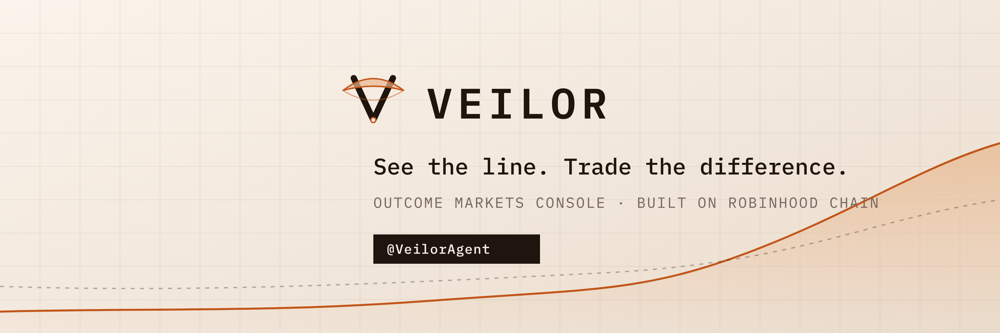

  

<h1 align="center">Veilor</h1>

  <b>See the line. Trade the difference.</b> 
  A console for prediction (outcome) markets, built on Robinhood Chain. 
  <a href="https://veilor.markets/">Live site</a> ·
  <a href="https://x.com/VeilorMarkets">@VeilorMarkets</a>

---

## Table of contents

1. [What is Veilor?](#what-is-veilor)
2. [What it does today](#what-it-does-today)
3. [What it does not do (yet)](#what-it-does-not-do-yet)
4. [A tour of the pages](#a-tour-of-the-pages)
5. [How the numbers are made](#how-the-numbers-are-made)
6. [Data sources](#data-sources)
7. [Wallet, portfolio and alerts](#wallet-portfolio-and-alerts)
8. [Language and theme](#language-and-theme)
9. [Keyboard shortcuts](#keyboard-shortcuts)
10. [What your browser stores](#what-your-browser-stores)
11. [Privacy and security](#privacy-and-security)
12. [Run it, host it, change it](#run-it-host-it-change-it)
13. [Repository contents](#repository-contents)
14. [Roadmap](#roadmap)
15. [FAQ](#faq)
16. [Disclaimer](#disclaimer)

---

## What is Veilor?

Prediction markets let you trade on the outcome of a question, for example "Will Bitcoin be above $90,000 on December 31?". Each market has a Yes price between $0 and $1, which the market treats as the probability of Yes.

Veilor is a read-only console on top of those markets. It brings together, in one screen:

- the live list of markets and their prices,
- the real order book of each market,
- the venue's own rules text and resolution source,
- an estimated "fair line" for crypto and gold price questions,
- the cost of an order at your size, before you trade,
- your wallet and portfolio on Robinhood Chain,
- price alerts.

Veilor's site is **one static HTML file** with no account. Your browser asks the public APIs listed below directly. A separate read-only Cloudflare Worker (in `worker/`) adds a datafeed, calendar feeds, an MCP server and the Telegram alert bot.

> **Important:** Veilor never places, signs or routes orders and never holds funds. The order ticket shows a quote, and its button opens the market on Polymarket, where you trade with your own account.

---

## What it does today

### Live markets
- Loads the most active Polymarket events (by 24-hour volume) and the Polymarket crypto events, and refreshes every 30 seconds.
- Shows each market's Yes and No price, 24-hour change, volume, liquidity and settlement date.
- Categories: All, Sports, Crypto, Politics, Macro, Equities, Commodities, IPO, Awards, Other.
- Search, sort (24h volume, edge, newest, settling soonest), filter by source and by time to cut-off (**Closing soon**), and a watchlist (star a market). The watchlist is saved in your browser and survives a reload.
- Every card shows the time left until the market closes.
- **Export CSV** downloads the current market list as a file, generated in your browser.
- Two views: Cards and Pro (list plus detail side by side).
- New listings view, Edges view (markets where a fair line differs from the price), Sets view.

### Market detail
- **Overview:** price, 24-hour change, price history chart (1D, 1W, 1M, All).
- **Order book:** the live Polymarket book with bids, asks and depth.
- **Rules:** the venue's rules text, resolution source, cut-off date, whether the market is part of a mutually exclusive set, and venue fee status.
- **Activity:** recent trades.
- **Outcomes:** the other outcomes of the same event.
- **Add to calendar:** downloads a `.ics` file for the settlement date.
- **Copy link** to a market, **Share on X** to post it, and **Compare** to put two markets side by side (price, depth, cut-off and rules).

### Order quote ticket
- Choose Buy or Sell, a size in shares or dollars, and an order type.
- Veilor walks the live order book and shows: shares that fill now, average fill price, price impact, notional, venue fee (only if the venue reports fees as enabled), and cost.
- A **price impact curve**, drawn from the live book, shows how the average price moves as your size grows.
- If the visible book cannot fill your size, it says so.
- The button **Trade on Polymarket** opens the market on Polymarket. The order type selector only describes what you would choose there.

### Model fair lines
- For price questions on **BTC, ETH, SOL, XRP, DOGE, BNB and gold**, Veilor shows a probability from a simple model (see [How the numbers are made](#how-the-numbers-are-made)).
- Supports "above", "below", "reach / hit" and "dip to / fall to" questions.
- Also lists model-only markets (labelled **Model**) for BTC, ETH, SOL and gold, built from live spot prices. They are estimates, not tradable markets.

### Live price strip
- A bar at the bottom shows BTC, ETH, SOL and gold spot prices with coin badges, refreshed every 8 seconds.

### Wallet and portfolio
- **Connect Wallet** uses your browser wallet (MetaMask, Rabby, Coinbase Wallet and others) and asks it to switch to Robinhood Chain (chain ID 4663), adding the network if needed. **WalletConnect** (Reown AppKit, loaded from pinned library versions) is also offered, for wallets on your phone. Veilor reads your address and balance only. It requests no signatures and no approvals, and the wallet dialog says so.
- **Portfolio CSV:** the portfolio can be exported as a file.
- **Portfolio** shows, for any address you paste or your connected wallet: ETH balance, token balances, number of transactions sent, whether it is a contract, recent transactions with explorer links, and open Polymarket positions with profit and loss.

### Alerts
- Alerts for a **spot price** (BTC, ETH, SOL, XRP, DOGE, BNB, gold), the **Yes price of a market**, or **new market listings** (optionally by category).
- Stored in your browser and checked while Veilor is open. Optional browser notifications.

### Status page
- Checks, live from your browser, whether each service Veilor depends on is reachable and how fast: Robinhood Chain RPC, the Blockscout API, Polymarket market data, Polymarket order books, and spot prices.

### Install, glossary and changelog
- **Install app:** Veilor can be installed from your browser menu or from the footer link (it ships a web app manifest and a minimal service worker). It is the same site, with no app store.
- A **Glossary** page explains terms such as Yes and No, spread, depth, slippage and resolution.
- A **Changelog** page lists recent changes, newest first.

### Interface
- Light theme (default) and dark theme, English and Chinese (中文), a responsive layout for phones, and animated backgrounds and a product tour on the home page that can be paused.

---

## What it does not do (yet)

These are real limits, not hidden features:

| Item | Status | Why |
|---|---|---|
| Placing or signing orders in Veilor | **Not available** | Veilor has no venue of its own. The ticket links to Polymarket. |
| Hosted read-only MCP server, datafeed, calendar feed | **Live** | Cloudflare Worker at https://veilor-worker.yansahsick.workers.dev (see `worker/`). Alerts need extra setup. |
| Hosted data feed API | **Live** | `/api/prices`, `/api/markets` and `/api/market/:id` on the Worker. Read-only, free-tier limits. |
| Calendar feed subscriptions | **Live** | `/cal/<category>.ics` on the Worker, for example `/cal/all.ics`. |
| Alerts while the page is closed | **Live (Telegram)** | Spot, market-price and new-market alerts via [@VeilorAlertsBot](https://t.me/VeilorAlertsBot). Browser alerts still need the page open. |
| Fair lines for non-crypto markets | **Not available** | There is no sound model for them, so the column stays empty. |
| Trading across several venues | **Planned** | Not built. |

---

## A tour of the pages

| Page | Address (after `#`) | What it is |
|---|---|---|
| Home | `/` | Product overview, animated tour, FAQ |
| How it works | `/how-it-works` | The five checks before an order |
| Pricing | `/pricing` | Veilor is free; explains venue fees |
| Roadmap | `/roadmap` | What exists and what is planned |
| Glossary | `/glossary` | The terms used in the console, in plain words |
| Changelog | `/changelog` | Recent changes, newest first |
| Developers | `/developers` | Datafeed, calendar feeds and the read-only MCP server |
| Open source | `/open-source` | The repository, its files and how to host it |
| Case study | `/case-study` | A worked example with a Bitcoin market (example values) |
| Docs | `/docs` | Guide to every number in the console |
| MCP for agents | `/docs/mcp` | How to connect to the live MCP server |
| Feature pages | `/features/<name>` | Live order books, fair lines, rules, order quotes, set tools, alerts, portfolio, developer access |
| Status | `/status` | Live health of each data source |
| About, Contact, Risk, Privacy, Terms | `/about` etc. | Plain-language info and legal pages |
| Console | `/console` | The markets workspace |
| Portfolio | `/portfolio` | Address lookup (also `/portfolio/<address>`) |
| Alerts | `/alerts` | Create and manage alerts |
| Fees | `/builder` | Explains that Veilor charges no fee |

The site uses hash routing, so every page works as a plain link such as `https://veilor.markets/#/console`.

---

## How the numbers are made

### Yes and No price
Taken from Polymarket's public market data. No is shown as the complement of Yes.

### Order quote
For a **buy**, Veilor walks the ask side of the live order book from the best price upward, filling your size level by level. For a **sell**, it walks the bid side downward. It then reports:

- **Shares filled now:** how many shares the visible book can fill.
- **Average fill:** total cost divided by shares filled.
- **Price impact:** the gap between the average fill and the best price.
- **Cost:** notional plus venue fee, when the venue reports fees as enabled.

The book changes constantly, so a real order may fill differently.

### Fair line (model)
Used for price questions on BTC, ETH, SOL, XRP, DOGE, BNB and gold.

- Inputs: the live spot price from Binance **S**, the strike **K** parsed from the question, the time left to settlement **t**, and a fixed annual volatility **σ** per asset.
- Model: a lognormal (Black-Scholes-style) probability with zero drift:

  `P(above K at T) = Φ( ln(S/K) / (σ√t) − σ√t / 2 )`

- "Below" questions use `1 − P(above)`.
- "Reach / hit" and "dip to / fall to" questions (touch of a level before the deadline) use the standard approximation of twice the probability of finishing beyond the level, capped at 99%.

Assumed volatilities: BTC 45%, ETH 62%, SOL 85%, XRP 75%, DOGE 95%, BNB 50%, gold 16%.

**This is a simple estimate.** It ignores jumps, fat tails, funding, correlations and much else. A gap between the market price and the fair line is **not** a trading signal.

### Model markets
Markets labelled **Model** are generated by Veilor from live spot prices and the same model. They are not listed on any venue and cannot be traded.

### Tags
- **Single:** the question is listed on one venue (Polymarket).
- **Model:** Veilor's own estimate, not tradable.
- **Close:** a listed price question that has a model fair line next to it.

### Market titles in Chinese
When the language is Chinese, market titles are machine-translated through the free MyMemory API and cached in the browser. Quality varies, and the free quota is limited. If it runs out, titles stay in English.

---

## Data sources

Every request is made from your browser. Nothing goes through a Veilor server.

| Data | Source |
|---|---|
| Markets, prices, volume, rules | Polymarket Gamma API (`gamma-api.polymarket.com`) |
| Order books, price history | Polymarket CLOB API (`clob.polymarket.com`) |
| Trades and positions | Polymarket Data API (`data-api.polymarket.com`) |
| Spot prices (BTC, ETH, SOL, XRP, DOGE, BNB, gold) | Binance, with CoinGecko and Coinbase as fallbacks |
| Model-market price history | Binance klines |
| Balances, nonce, contract check, block number | Robinhood Chain public RPC (`rpc.mainnet.chain.robinhood.com`) |
| Token balances, transactions | Blockscout (`robinhoodchain.blockscout.com`) |
| Title translation (Chinese mode only) | MyMemory API |

Robinhood Chain details used by the wallet: chain ID `4663` (`0x1237`).

Veilor is **not affiliated** with Polymarket, Binance, CoinGecko, Coinbase, Blockscout, MyMemory or Robinhood. Their names only describe where data comes from.

If a source is blocked (a strict network, ad blocker or VPN), the related part of the console shows a clear message and Veilor retries automatically. The Status page shows which source is failing.

---

## Wallet, portfolio and alerts

### Connecting a wallet
1. Open the Console and press **Connect Wallet**.
2. Your wallet asks permission to share your address. Approve it.
3. If the wallet is on another network, it asks to switch to Robinhood Chain (and to add the network if it is missing).
4. Your short address appears in the top bar. Veilor remembers the choice in your browser and reconnects next time.

On a phone, browser wallets only work inside a wallet's own browser (for example the MetaMask or Rabby in-app browser). In a normal mobile browser, use the WalletConnect option instead.

### Portfolio lookup
Open **Portfolio**, paste any address (`0x` followed by 40 hex characters), and press **Look up**. You can also press **Use my wallet**. If the address has open Polymarket positions, they are listed with size, average price, current price and profit and loss.

### Alerts
1. Open **Alerts**.
2. Choose the kind (spot price, market price, or new markets), the asset or market, the direction (goes above or below), and a level.
3. Press **Add alert**. Optionally press **Enable browser notifications**.

Alerts are checked while Veilor is open in a browser tab. When one triggers, it is marked as triggered and a notification appears, if you allowed notifications. Clearing the site data removes all alerts.

**Telegram alerts (page closed):** message [@VeilorAlertsBot](https://t.me/VeilorAlertsBot) and send:

| Command | What it does |
|---|---|
| `/alert BTC above 100000` | Spot price alert (BTC, ETH, SOL, XRP, DOGE, BNB, GOLD) |
| `/markets bitcoin` | Find a market id (searches the most active markets) |
| `/alert market 12345 above 60` | Alert when that market's Yes price crosses 60¢ |
| `/watch Crypto` | Message me when a new Crypto market is listed (`All` for every category) |
| `/digest on` | One message a day, at about 08:00 UTC, with spot prices and the status of your alerts. `/digest off` stops it |
| `/unwatch Crypto`, `/alerts`, `/clear` | Stop watching, list everything, delete everything |

These run on the Worker every minute. Price alerts fire once, then are removed. At most 10 alerts and 5 watches per chat, and market alerts are checked for up to 20 distinct markets per minute across all users. New markets are detected from Polymarket's newest events and can be delayed by a minute or more. Your Telegram chat id is stored on the Worker to send the message. The bot never trades.

---

## Language and theme

- **Theme:** the light cream-and-peach theme is the default. Press the ◐ button to switch to dark. The choice is saved.
- **Language:** press 中文 / EN to switch between English and Chinese. All pages are translated, including the Console, Portfolio and Alerts. A few long sentences and brand names may stay in English. Market titles are machine-translated as described above. The choice is saved.

---

## Keyboard shortcuts

In the Console (press `?` anywhere to see this list):

| Key | Action |
|---|---|
| `/` | Focus the market search |
| `j` / `k` | Move down / up the market list |
| `Enter` | Open the selected market |
| `b` / `s` | Open the ticket on Buy / Sell |
| `g` then `m` | Go to Markets |
| `g` then `n` | Go to New listings |
| `g` then `e` | Go to Edges |
| `g` then `p` | Go to Portfolio |
| `g` then `a` | Go to Alerts |
| `g` then `c` | Go to the Payoff calculator |
| `g` then `l` | Go to the Trade journal |
| `g` then `d` | Go to Your data |
| `g` then `w` | Go to the Watchlist |
| `?` | Show the shortcut list |
| `Esc` | Close a dialog or leave the search box |

---

## What your browser stores

Veilor stores a few things in your browser's local storage, and nothing else:

| Key | What it holds |
|---|---|
| `veilor-theme` | Light or dark |
| `veilor-lang` | English or Chinese |
| `veilor-al` | Your alerts |
| `veilor-w` | Whether to reconnect your wallet automatically |
| `veilor-wl` | Your watchlist (starred markets) |
| `veilor-mt` | Cached Chinese translations of market titles |

To remove everything, clear this site's data in your browser settings.

---

## Privacy and security

- No account, no login, no cookies set by Veilor, and no backend for the site itself.
- The Telegram bot stores your Telegram chat id and your alert settings so it can message you. Send `/clear` to delete your alerts. The Worker never signs or places orders.
- Your browser contacts the public APIs listed above directly. Those services can see your IP address, like any website you visit. Addresses you look up in Portfolio are sent to the Robinhood Chain RPC, Blockscout and Polymarket to fetch their data.
- Veilor never asks for a seed phrase or private key. Never enter one on any website.
- Wallet connection requests your address only, with no signature and no spending approval.
- Text coming from third-party APIs (such as market titles) is escaped before it is shown.
- Always check the address bar. The only official site is the one linked at the top of this page.

---

## Run it, host it, change it

### Run locally
Veilor is a single file. Download `index.html` and open it in a normal desktop or mobile browser **with internet access**. Some in-app viewers block network requests, so live data will not load there.

### Host on GitHub Pages
1. Put `index.html` (and the images used by this README) in a repository.
2. Open **Settings → Pages**.
3. Under **Build and deployment**, choose **Deploy from a branch**, then **main** and **/ (root)**, and **Save**.
4. After a minute or two the site is live at `https://<user>.github.io/<repository>/`.

A custom domain can be added in the same Pages settings.

### Change it
Everything (markup, styles, scripts, and the IBM Plex Mono font) lives in `index.html`. The script at the bottom contains the data layer: live prices and the fair-line model, the Polymarket client, wallet and portfolio, alerts, translation and routing. Edit the file, commit, and Pages republishes it.

---

## Repository contents

| File | Purpose |
|---|---|
| `index.html` | The whole application |
| `manifest.webmanifest` | Web app manifest, so Veilor can be installed |
| `sw.js` | A minimal service worker (it caches nothing) |
| `worker/` | The read-only Cloudflare Worker: datafeed, calendar feeds, MCP server and the Telegram bot |
| `img/` | Coin, wallet and venue logos |
| `README.md` | This document |
| `header.png` | Banner used at the top of this README and for link previews |
| `logo.svg` | The Veilor logo (vector) |
| `logo.png` | The Veilor logo (2000×2000) |

The font IBM Plex Mono is embedded in `index.html` under the SIL Open Font License 1.1.

---

## Token

$VEILOR on Robinhood Chain (chain ID 4663). Contract: `0x4d2ed6a271f17dd51ae7cd61ff81a26c9877f37d`. Official site: https://veilor.markets. Official X account: @VeilorMarkets. Veilor is read-only and never asks for a seed phrase, a private key or a signature.

---

## Roadmap

**Available now:** the console described above.

**Planned, not built:**
- Trading across more than one venue.

Dates are not promised. Items move from "planned" to "available" only when they work.

---

## FAQ

**Does Veilor hold my money or place trades?**
No. Veilor has no custody and does not place orders. You trade on Polymarket with your own account.

**Does Veilor charge a fee?**
No. The venue where you trade may charge its own fees.

**Why is the console empty for me?**
Most likely your browser or network blocks the Polymarket API (some in-app viewers, ad blockers and VPNs do). Open the Status page to see which source is failing, and try a normal browser.

**Why does a market show "–" for the fair line?**
Fair lines exist only for crypto and gold price questions. Other markets have no sound model behind them.

**Can I trust the fair line?**
Treat it as a rough reference. It is a simple model with fixed volatility and can be wrong.

**Why does Connect Wallet do nothing on my phone?**
A normal mobile browser has no browser wallet. Use the **WalletConnect** option, or open Veilor inside your wallet app's browser.

**Are my alerts sent to a server?**
Browser alerts: no. They live in your browser and only run while Veilor is open. Telegram alerts: yes, the Worker stores your chat id and the alert rules so it can message you.

**Which chain does Veilor use?**
Robinhood Chain (chain ID 4663) for the wallet and portfolio. The markets themselves are Polymarket's.

---

## Disclaimer

Prediction markets can lose value quickly and you can lose everything you put in. Fair lines are model estimates and can be wrong. Prices, order books and rules come from third-party APIs and may be delayed or incorrect, so check them on the venue before you trade. Veilor provides information only. Nothing here is investment, legal or tax advice. Use it at your own risk.
